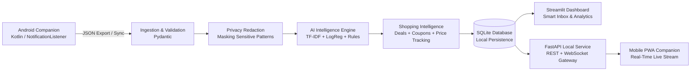

# NotifyIQ 🔔
> **A Privacy-First, Explainable AI System for Intelligent Android Notification Prioritization**

[](https://www.python.org/)
[](LICENSE)
[]()
[]()

---

## 1. Problem Statement

Modern smartphone users receive dozens of notifications daily from messaging platforms, banks, educational systems, delivery apps, social media, and system services. Critical alerts (such as project deadlines, security warnings, or payment verifications) routinely get buried under marketing promotions, repetitive spam, and low-priority social chatter.

Existing notification managers often suffer from major drawbacks:
1. **Coarse app-level muting** that silences important messages alongside noise.
2. **Privacy invasion**, transmitting personal notification bodies to third-party cloud LLMs.
3. **Black-box decisions**, offering no explanation for why a message was hidden or ranked.

---

## 2. The NotifyIQ Solution

**NotifyIQ** transforms unorganized notification streams into an intelligent, explainable, privacy-conscious management system by answering five core questions:
1. **What type of notification is this?** (6-class categorization)
2. **How important is it?** (Deterministic, transparent priority scoring)
3. **Does it require an action?** (Grammar-aware action extraction)
4. **Does it contain a deadline?** (Timezone-aware relative/absolute deadline parsing)
5. **Why did the AI assign this priority?** (Human-auditable explanation factor list)

NotifyIQ is a **decision-support tool**: it never automatically replies, dismisses notifications, or executes financial actions on the user's behalf.

---

## 3. Key Features

- 📱 **Real-Time Mobile Companion (Installable PWA)**: Installable directly onto Android & iOS devices without an app store. Features real-time WebSocket live-streaming, haptic vibration, push notifications, and a mobile-optimized card interface.
- 🔒 **100% Local & Privacy-First**: Offline execution using SQLite, scikit-learn, and rule-based extractors. Zero third-party cloud AI APIs; zero external subscriptions.
- 🤖 **Native Android Companion**: Kotlin-based `NotificationListenerService` that respects explicit user permissions, supports app allowlists, instant pause toggle, and records dismissal events.
- ⚙️ **Notification Service & Lifecycle Orchestration**: End-to-end management service with Smart Inbox multi-criteria filtering, attention summaries (overdue deadlines, unread high-priority, open actions), read/unread status tracking, and per-app analytics.
- 🌙 **Quiet Hours & Notification Deferral**: Timezone-aware quiet hours scheduling (e.g., 22:00 to 07:00) that captures notifications without dropping context, marking them as deferred to suppress alerts during downtime.
- 🛡️ **Hard Package Exclusions**: Pre-capture (Android) and pre-ingestion (backend) package exclusion lists allowing complete blacklisting of sensitive applications (banking, private messengers) from intelligence pipelines and database storage.
- 🛍️ **Shopping Intelligence (BuyHatke-Style)**: Offline deal discovery, multi-currency price and discount extraction, deal quality scoring ($0-100$), coupon code detection, and historical price drop tracking without remote cloud tracking.
- 🤖 **Hybrid AI Architecture**: Combines TF-IDF + Logistic Regression classification with deterministic rule fallback and grammar-based information extraction.
- ⚖️ **Explainable Priority Formula**: Auditable scoring based on Urgency, Action Requirement, Deadline Proximity, User Importance, and Recency Decay.
- 🔁 **Two-Level Duplicate Grouping**: Deterministic exact SHA-256 fingerprinting plus conservative near-duplicate similarity without ever discarding source notifications.
- 📊 **Interactive Streamlit Dashboard**: 7 comprehensive pages (Overview, Smart Inbox, Notification Details, Action Center, Duplicate Center, Analytics & Evaluation, Settings & Privacy) with rich Plotly charts.
- ✍️ **Human-in-the-Loop Feedback**: Active feedback recording stored locally in SQLite to refine future models.

---

## 4. Architecture & Technology Stack



### Technology Stack
- **Android App**: Kotlin, Android SDK 34, AndroidX, Material 3.
- **Python Backend**: Python 3.11 / 3.14 compatible.
- **Machine Learning**: `scikit-learn` (TF-IDF vectorizer + Logistic Regression).
- **Storage**: SQLite 3 with foreign keys, indexes, and schema migration tracking.
- **API & Streaming**: FastAPI, Uvicorn, WebSockets, Pydantic v2.
- **Dashboard**: Streamlit, Plotly, Pandas, NumPy.
- **Testing**: `pytest`, `TestClient` (60+ automated tests).

---

## 5. Priority Scoring Formula

NotifyIQ uses a transparent, deterministic scoring formula bounded between $0$ and $100$:

$$\text{Priority Score } (P) = 0.30 U + 0.25 A + 0.25 D + 0.15 I + 0.05 R$$

Where:
- **$U$ (Urgency, $0-100$)**: Contextual cues (security alerts $= 95$, urgent language $= 85$, promotional $= 10$).
- **$A$ (Action Requirement, $0-100$)**: Action with deadline $= 100$, explicit action $= 80$, potential action $= 50$, none $= 0$.
- **$D$ (Deadline Proximity, $0-100$)**: Overdue $= 95$, $<1\text{h} = 100$, $<24\text{h} = 90$, $1-2\text{d} = 70$, $3-7\text{d} = 40$, $>7\text{d} = 20$, none $= 0$.
- **$I$ (User Importance, $0-100$)**: User package overrides, financial/work apps $= 80$, promo $= 15$, default $= 50$.
- **$R$ (Recency Decay, $0-100$)**: Exponential decay: $R = 100 \times \exp(-\text{age\_hours} / \tau)$ where $\tau = 24.0\text{ hours}$.

### Priority Levels
- **High**: $70.0 - 100.0$ (Requires prompt attention; highlighted at top)
- **Medium**: $40.0 - 69.99$ (Standard priority)
- **Low**: $0.0 - 39.99$ (Informational or marketing updates)

---

## 6. Shopping Intelligence (BuyHatke-Style)

NotifyIQ includes an offline shopping intelligence suite designed to surface high-value deals and coupons buried within promotional spam without sending private browsing data or shopping activities to third-party ad networks.

### 1. Price & Currency Extraction (`price_extractor.py`)
- Extracts current prices, original / MRP prices, and percentage discounts across global currencies (₹ INR, $ USD, € EUR, £ GBP).
- Understands complex natural language expressions: `"Flat ₹5,000 off on ₹24,999"`, `"Now ₹899 down from ₹2,499"`, `"Save 40% today"`.

### 2. Deal Quality Scoring (`deal_scorer.py`)
- Calculates an objective **Deal Score ($0-100$)** combining:
  - Relative discount depth (percentage savings)
  - Absolute monetary savings
  - Urgency indicators (flash sales, lightning deals, expiring timers)
  - Merchant trustworthiness and popularity
- Assigns human-readable quality badges: `Exceptional Deal` (80+), `Great Deal` (65+), `Good Deal` (50+), `Fair Deal` (35+), or `Regular Price`.

### 3. Coupon Code Discovery (`coupon_detector.py`)
- Automatically harvests promo codes, discount vouchers, and referral bonuses (e.g., `SAVE20`, `DIWALI500`, `FESTIVE1000`).
- Employs strict negative filtering to discard common false positives like order numbers, tracking IDs, transaction references, and generic uppercase words.

### 4. Historical Price Drop Tracking (`shopping_service.py`)
- Maintains a local SQLite timeline of observed product prices (`shopping_price_history`).
- Compares new offers against historical price points to detect genuine price drops and all-time low alerts.

### 5. Radical Privacy Advantage
Commercial shopping extensions (such as Honey or BuyHatke) frequently monitor browsing sessions, capture shopping carts, and redirect affiliate links. NotifyIQ's shopping module runs **100% offline and locally**, processing only incoming notification text and storing all history in local SQLite.

---

## 7. Project Structure

```
NotifyIQ/
├── README.md                          # Main project documentation
├── requirements.txt                   # Pinned Python dependencies
├── .gitignore                         # Git ignore rules
├── .env.example                       # Documented environment variables
│
├── backend/
│   ├── __init__.py
│   ├── main.py                        # FastAPI entry point & lifespan
│   ├── api/
│   │   ├── __init__.py
│   │   ├── routes.py                  # API routes (import, actions, feedback, settings, etc.)
│   │   ├── schemas.py                 # Pydantic request & response models
│   │   └── shopping_routes.py         # Shopping Intelligence REST endpoints
│   ├── ai/
│   │   ├── __init__.py
│   │   ├── preprocess.py              # Unicode, whitespace, and pattern redaction
│   │   ├── classifier.py              # ML classifier + rule fallback
│   │   ├── action_extractor.py        # Grammar-based task detection
│   │   ├── deadline_extractor.py      # Timezone-aware deadline parsing
│   │   ├── priority_engine.py         # Formula-based scoring & explainability
│   │   ├── duplicate_detector.py      # Level 1 fingerprint & Level 2 similarity
│   │   ├── pipeline.py                # End-to-end processing pipeline
│   │   └── shopping/                  # Shopping Intelligence Engine (BuyHatke-style)
│   │       ├── __init__.py
│   │       ├── price_extractor.py     # Regex and heuristic price/discount extractor
│   │       ├── deal_scorer.py         # 0-100 deal quality scoring engine
│   │       └── coupon_detector.py     # Promo code & voucher discovery
│   ├── database/
│   │   ├── __init__.py
│   │   ├── connection.py              # SQLite connection context & migrations
│   │   ├── schema.py                  # DDL statements and table schemas
│   │   └── repository.py              # Parameterized SQL repository
│   ├── services/
│   │   ├── __init__.py
│   │   ├── import_service.py          # JSON import/export validation
│   │   ├── evaluation_service.py      # Comprehensive model evaluation
│   │   ├── notification_service.py    # Notification orchestration, quiet hours & exclusions
│   │   └── shopping_service.py        # Deals aggregation & price history tracking
│   ├── static/                        # Mobile Companion Web App (PWA)
│   │   ├── icons/                     # PWA home screen icons (192x192, 512x512)
│   │   └── mobile/
│   │       ├── index.html             # Responsive mobile notification stream UI
│   │       ├── manifest.json          # Web app manifest for A2HS installation
│   │       └── service-worker.js      # Offline caching and notification handler
│   ├── utils/
│   │   ├── __init__.py
│   │   ├── configuration.py           # Configuration management
│   │   └── logging_config.py          # Privacy-preserving logging
│   └── tests/                         # Full automated test suite (60+ tests)
│       ├── test_database.py
│       ├── test_import.py
│       ├── test_preprocessing.py
│       ├── test_classifier.py
│       ├── test_deadlines.py
│       ├── test_priority.py
│       ├── test_duplicates.py
│       ├── test_pipeline.py
│       ├── test_notification_service.py # Smart inbox, quiet hours, retention & exclusions
│       ├── test_shopping.py           # Price extraction, deal scoring, coupons & history
│       └── test_api.py                # Integration tests for REST endpoints
│
├── dashboard/
│   ├── app.py                         # Streamlit multi-page dashboard
│   ├── charts.py                      # Plotly visualizations
│   └── components.py                  # HTML/CSS UI cards and badges
│
├── android/                           # Complete Kotlin Android companion app
│   ├── settings.gradle.kts
│   ├── build.gradle.kts
│   └── app/
│       ├── build.gradle.kts
│       └── src/main/
│           ├── AndroidManifest.xml
│           ├── java/org/notifyiq/app/
│           │   ├── MainActivity.kt
│           │   ├── NotificationCaptureService.kt
│           │   ├── NotificationEvent.kt
│           │   ├── JsonExporter.kt
│           │   └── SettingsManager.kt
│           └── res/
│
├── data/
│   ├── sample_notifications.json      # 50 Android-compatible notification events
│   ├── shopping_notifications.json    # 25 real-world e-commerce & deal notifications
│   ├── training_notifications.csv     # 326 labeled synthetic training records
│   └── evaluation_notifications.csv   # 126 held-out evaluation records
│
├── models/
│   ├── category_classifier.joblib     # Trained TF-IDF + LogReg pipeline
│   ├── model_metadata.json            # Model parameters & CV metrics
│   └── evaluation_report.json         # Benchmark report on held-out test data
│
├── scripts/
│   ├── initialize_database.py         # Sets up local SQLite schema
│   ├── generate_sample_data.py        # Generates deterministic datasets
│   ├── train_model.py                 # Trains and persists ML classifier
│   ├── evaluate_model.py              # Generates evaluation benchmarks
│   └── import_notifications.py        # Imports JSON notification files
│
└── docs/
    ├── architecture.md                # System architecture & Mermaid diagrams
    ├── privacy.md                     # Privacy model, redaction, quiet hours & retention
    ├── api.md                         # REST API & Shopping documentation
    ├── testing.md                     # Test suite documentation & coverage
    └── demo_guide.md                  # 3-5 minute presentation walkthrough
```

---

## 8. Quickstart Guide (Step-by-Step)

### Step 1: Install Dependencies
```bash
pip install -r requirements.txt
```

### Step 2: Initialize Database
```bash
python scripts/initialize_database.py
```

### Step 3: Generate Synthetic Datasets
```bash
python scripts/generate_sample_data.py
```

### Step 4: Train the Category Classifier
```bash
python scripts/train_model.py
```

### Step 5: Evaluate Model on Held-Out Test Data
```bash
python scripts/evaluate_model.py
```

### Step 6: Import Sample Notifications into Database
```bash
python scripts/import_notifications.py --file data/sample_notifications.json
python scripts/import_notifications.py --file data/shopping_notifications.json
```

### Step 7: Launch Interactive Streamlit Dashboard
```bash
streamlit run dashboard/app.py
```
*The dashboard will open automatically in your browser at `http://localhost:8501`.*

### Step 8: (Optional) Launch FastAPI Backend Service & Mobile Companion Gateway
```bash
uvicorn backend.main:app --host 0.0.0.0 --port 8000
```
*API docs available at `http://127.0.0.1:8000/docs`.*
*Scan the QR code displayed in the dashboard or navigate to `http://<your-lan-ip>:8000/mobile` to install the mobile PWA companion.*

### Step 9: Run Automated Tests
```bash
python -m pytest backend/tests/ -v
```
*Runs the full suite of 60+ unit, integration, and API tests.*

---

## 9. Android Companion App Build Instructions

The Android application is located in `android/`.

1. Open **Android Studio** (Hedgehog or newer recommended).
2. Select **Open Project** and navigate to `c:\Users\Amay\Downloads\VR-Headset-main\android`.
3. Allow Gradle to sync dependencies (Android SDK 34, AGP 8.5.2, Kotlin 2.0.20).
4. Connect an Android phone (Android 8.0 / API 26+) or launch an Android Emulator.
5. Click **Run 'app'** (`Shift + F10`).
6. In the app:
   - Tap **Grant Notification Access** $\rightarrow$ Toggle NotifyIQ in Android System Settings.
   - Use the **Enable Notification Capture** toggle to pause/resume capture.
   - Tap **Export Captured Events (JSON)** to save the captured stream to the device's external storage.
   - Transfer the exported `.json` file to the host and import using:
     ```bash
     python scripts/import_notifications.py --file path/to/notifyiq_export.json
     ```

---

## 10. Evaluation Results (Held-Out Test Set)

Evaluated against `data/evaluation_notifications.csv` (126 samples with seed 99, completely held out from training):

| Metric | NotifyIQ (TF-IDF + LogReg) | Keyword Baseline | Improvement |
|---|---|---|---|
| **Category Accuracy** | **97.62%** | 68.25% | **+29.37%** |
| **Category Macro-F1** | **0.9429** | 0.6988 | **+0.2441** |
| **High-Priority Precision** | **100.00%** | 72.41% | **+27.59%** |
| **High-Priority Recall** | **88.46%** | 80.77% | **+7.69%** |
| **Action Extraction F1** | **0.8955** | — | — |
| **Median Inference Latency**| **6.66 ms** | 0.42 ms | Sub-10ms offline |

---

## 11. Privacy & Security Model

- **No Remote AI Cloud**: All ML inferences occur on the local CPU; no credentials or API keys required.
- **Redaction by Default**: Emails, phone numbers, account digits, URLs, and OTPs are automatically masked.
- **Privacy-Preserving Logs**: Application logs never include raw notification text.
- **Quiet Hours & Deferrals**: Sensitive or off-hours notifications can be scheduled to defer alert interrupts.
- **Package Exclusion Control**: Full device-side and server-side exclusion prevent sensitive apps from being tracked.
- **Local Shopping Intelligence**: Price histories, coupons, and deals remain 100% on localhost with zero tracking.
- **Complete Data Purge**: Single-click purge permanently wipes all stored notifications, actions, and feedback.

---

## 12. Known Limitations & Future Improvements

1. **Synthetic Training Data**: The ML model is trained on diverse synthetic notification templates. In production, fine-tuning on consented, user-labeled historical notifications will improve domain edge-case recall.
2. **Ambiguous Deadlines**: Complex date expressions without reference dates (e.g., "by next week") are marked as `unresolved` by design to prevent false calendar entries.
3. **Future Roadmap**:
   - On-device local quantization (ONNX Runtime / GGUF) for edge devices.
   - Direct encrypted Bluetooth/WiFi local pairing between Android companion and local dashboard.
   - Native Android reminder notifications for user-confirmed actions.

---

## 13. License

This project is licensed under the MIT License.
