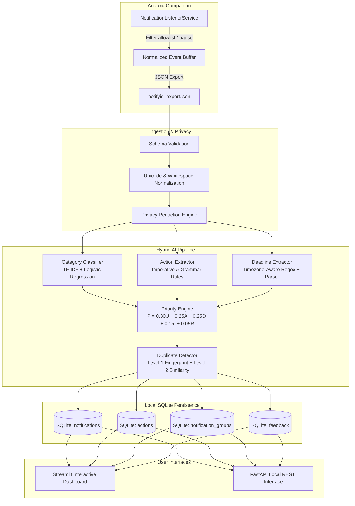

# NotifyIQ — System Architecture & Data Flow

## 1. System Overview

NotifyIQ is an explainable, privacy-first notification intelligence system designed to alleviate notification overload without sacrificing user privacy. It operates on a **hybrid intelligence architecture** that combines supervised machine learning (TF-IDF + Logistic Regression) with deterministic rule-based extractors and an explainable scoring formula.

## 2. Component Breakdown

### 2.1 Android Companion (`android/`)
- **Technology**: Kotlin, Android SDK 34, Material 3.
- **Service**: `NotificationCaptureService` extends `NotificationListenerService`.
- **User Agency**: Explicit permission requested via Android system settings.
- **Privacy Gate**: Checks allowlist before capturing; skips excluded packages.
- **Export**: Emits schema-versioned JSON events.

### 2.2 Text Preprocessing & Redaction (`backend/ai/preprocess.py`)
- Unicode NFKC standard normalization.
- Whitespace cleanup.
- Masking of common sensitive patterns (`[EMAIL]`, `[PHONE]`, `[ACCOUNT]`, `[URL]`, `[CODE]`).
- Separation of permitted original text and normalized classification text.

### 2.3 Category Classifier (`backend/ai/classifier.py`)
- 6 Categories: `action_required`, `transactional`, `social`, `promotional`, `system`, `unknown`.
- Scikit-learn Pipeline: `TfidfVectorizer(ngram_range=(1,2))` + `LogisticRegression(class_weight='balanced')`.
- Deterministic rule-based fallback if ML artifact is missing or corrupted.
- Confidence reporting; flags `needs_review=True` if confidence is below threshold.

### 2.4 Action Extractor (`backend/ai/action_extractor.py`)
- Contextual grammar matching for 20+ action verbs (`submit`, `review`, `approve`, `pay`, `complete`, etc.).
- Distinguishes explicit imperative requests from incidental words.

### 2.5 Deadline Extractor (`backend/ai/deadline_extractor.py`)
- Resolves relative and absolute time expressions using the notification's arrival timestamp as reference.
- Explicit timezone awareness (`Asia/Kolkata` or configured default).
- Flags ambiguous expressions as `unresolved` rather than inventing deadlines.

### 2.6 Explainable Priority Engine (`backend/ai/priority_engine.py`)
- Transparent formula:
  $$\text{Priority} = 0.30U + 0.25A + 0.25D + 0.15I + 0.05R$$
- Each component bounded in $[0, 100]$.
- Priority levels: High ($\ge 70$), Medium ($40 - 69.99$), Low ($< 40$).
- Traceable reason explanations generated from computed factors.

### 2.7 Duplicate Detector (`backend/ai/duplicate_detector.py`)
- Level 1: Deterministic 16-character SHA-256 fingerprint on normalized package + title + text.
- Level 2: TF-IDF cosine similarity for near-duplicate updates.
- Source records are never discarded.

### 2.8 Local Database (`backend/database/`)
- Offline SQLite database with foreign keys, indexes, and schema version migrations.
- Complete cascade deletion on purge.
